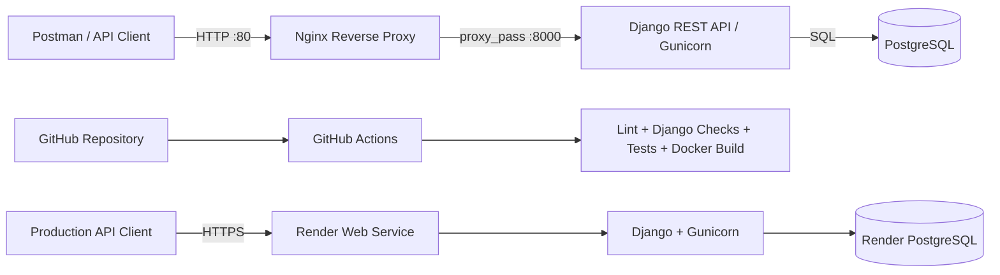

# Pharmacy Management Platform — Architecture

## Overview

The Pharmacy Management Platform is a Django REST Framework API backed by PostgreSQL. Docker Compose runs the API, database, and Nginx reverse proxy locally. The production API is deployed to Render, which provides HTTPS and connects to a managed PostgreSQL database. GitHub Actions runs the CI checks when code is pushed or a pull request is opened.

## Architecture

## Main components

- **Django REST Framework:** medicine catalogue, batches, stock movements, reports, authentication, and health endpoints.
- **PostgreSQL:** persistent relational data store.
- **Gunicorn:** production WSGI application server.
- **Nginx:** local reverse proxy; forwards requests to the `web` service on port 8000.
- **Docker Compose:** starts the local API, database, and Nginx services.
- **GitHub Actions:** runs lint/static checks, Django checks, tests, and a Docker image build.
- **Render:** hosts the production web service and managed PostgreSQL database.

## Important domain rules

- Batch quantities and prices must satisfy model validation.
- Stock changes are recorded as auditable stock movements.
- A sale must not make stock negative.
- Sales from expired batches are rejected.
- Stock updates use a database transaction and row-level locking to reduce overselling risk.

## Local request flow

1. A client sends a request to `http://127.0.0.1`.
2. Nginx forwards the request to the Django/Gunicorn service.
3. Django authenticates protected API requests and validates the input.
4. The API reads or updates PostgreSQL.
5. The API returns a JSON response through Nginx.
